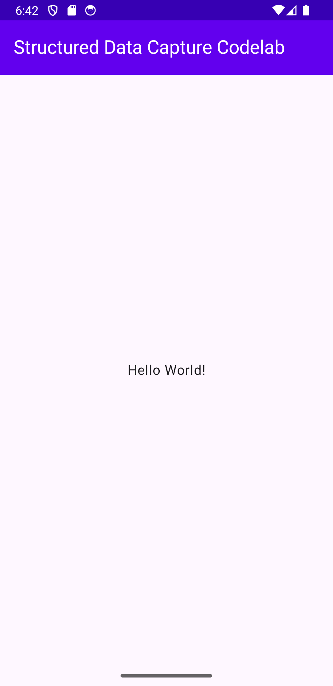

# Capture and process health data with Kotlin FHIR Data Capture

## 1. Before you begin

### What you'll build

In this codelab, you're going to build a Kotlin Multiplatform app with the Kotlin FHIR Data
Capture library. Your app will use the library to render and process FHIR Questionnaires and
responses. The same code runs on Android, iOS, Desktop (JVM) and Web (Wasm and JS).

### What you'll learn

*   How to integrate Kotlin FHIR Data Capture into your Kotlin Multiplatform application
*   How to display a Questionnaire
*   How to get answers as a QuestionnaireResponse
*   How to extract FHIR resources from a QuestionnaireResponse

### What you'll need

*   A recent version of [Android Studio](https://developer.android.com/studio)
*   [Android Emulator](https://developer.android.com/studio/run/emulator) or a physical Android device
*   Optional: a Mac with [Xcode](https://developer.apple.com/xcode/) to run the iOS app
*   The sample code
*   Basic knowledge of Kotlin and [Jetpack Compose](https://developer.android.com/compose)

This codelab is focused on
[Kotlin FHIR Data Capture](https://github.com/ohs-foundation/kotlin-fhir-data-capture).
Non-relevant concepts and code blocks are glossed over and are provided for you to simply copy and
paste. If you haven't built a Kotlin Multiplatform app before, you can start by
[creating your first Compose Multiplatform app](https://www.jetbrains.com/help/kotlin-multiplatform-dev/compose-multiplatform-create-first-app.html).

## 2. Get set up

### Download the Code

To download the code for this codelab, you only need the `codelabs` folder of the Kotlin FHIR Data
Capture repo. You can fetch just that part of the repo with a
[sparse checkout](https://git-scm.com/docs/git-sparse-checkout) (Git 2.25 or later):

```shell
git clone --depth 1 --filter=blob:none --sparse https://github.com/ohs-foundation/kotlin-fhir-data-capture.git
cd kotlin-fhir-data-capture
git sparse-checkout set codelabs gradle
```

The `gradle` folder is needed too, because the codelab reads its library versions from
`gradle/libs.versions.toml` at the root of the repo.

Alternatively, you can clone the whole repo:

```shell
git clone https://github.com/ohs-foundation/kotlin-fhir-data-capture.git
```

The starter project for this codelab is located in `codelabs/`.

### Project structure

| Module       | Contents                                                                                      |
|:-------------|:----------------------------------------------------------------------------------------------|
| `shared`     | Kotlin Multiplatform module. `commonMain` holds the `App()` composable and the questionnaire. |
| `androidApp` | Android application. `MainActivity` calls `setContent { App() }`.                             |
| `desktopApp` | Desktop (JVM) application. `main()` opens a window that shows `App()`.                        |
| `webApp`     | Web application for Wasm and JS. `main()` shows `App()` in the browser page.                  |
| `iosApp`     | Xcode project for iOS. It shows `App()` through `MainViewController()` in `shared/iosMain`.   |

The platform modules are just entry points. Everything you'll write in this codelab goes into two
files of the `shared` module:

*   `shared/build.gradle.kts`
*   `shared/src/commonMain/kotlin/dev/ohs/fhir/codelab/App.kt`

Each place you'll change is marked with a numbered comment, such as
`// 4 Replace with code from the codelab to display the questionnaire.` The number tells you which
step of the codelab adds the code.

The questionnaire is stored as a
[Compose Multiplatform resource](https://www.jetbrains.com/help/kotlin-multiplatform-dev/compose-multiplatform-resources.html)
at `shared/src/commonMain/composeResources/files/questionnaire.json`, so every platform can read it.

### Import the app into Android Studio

Let's start by importing the starter app into Android Studio.

Open Android Studio, select **Open** and choose the `codelabs` folder from the source code that you
have downloaded earlier.


### Run the starter app

Now that you have imported the project into Android Studio, you are ready to run the app for the
first time.

Connect your Android device via USB to your host, or
[start the Android Studio emulator](https://developer.android.com/studio/run/emulator). Select the
`androidApp` run configuration and click **Run** in the Android Studio toolbar. You can also
install the app from the command line:

```shell
./gradlew :androidApp:installDebug
```

<p align="left">

</p>

As you can see there isn't much here yet, so let's get right into displaying a questionnaire in
your app!

### Run the app on other platforms

Because the app is built with Kotlin Multiplatform, you can run it on other platforms too, at any
step of the codelab:

| Platform      | Command or action                                                                    |
|:--------------|:-------------------------------------------------------------------------------------|
| Desktop (JVM) | `./gradlew :desktopApp:run`                                                          |
| Web (Wasm)    | `./gradlew :webApp:wasmJsBrowserDevelopmentRun`                                      |
| Web (JS)      | `./gradlew :webApp:jsBrowserDevelopmentRun`                                          |
| iOS           | Open `iosApp/iosApp.xcodeproj` in Xcode, select a simulator, and click **Run**.      |

On iOS, Xcode builds the `shared` framework with Gradle. To run on a real device, see
[`iosApp/README.md`](iosApp/README.md).

## 3. Add Kotlin FHIR Data Capture to the project

### Add the dependency for Kotlin FHIR Data Capture

The Kotlin FHIR Data Capture dependency allows you to integrate the library in your app. Add the
following line below the `// 3 Add the dependency for Kotlin FHIR Data Capture` comment in the
`commonMain` dependencies of the `shared/build.gradle.kts` file:

```kotlin
kotlin {
  sourceSets {
    commonMain.dependencies {
      // ...

      // 3 Add the dependency for Kotlin FHIR Data Capture
      implementation("dev.ohs.fhir:fhir-data-capture:2.0.0-alpha05")
    }
  }
}
```

Because the dependency is in `commonMain`, Gradle picks the right artifact for each target
platform. The `androidApp`, `desktopApp` and `webApp` modules get the library through their
dependency on `shared`.

The starter project already includes the [Kotlin FHIR](https://github.com/ohs-foundation/kotlin-fhir)
model and `kotlinx-serialization-json`, which you'll use later in the codelab.

### Sync your project with Gradle files

To be sure that all dependencies are available to your app, you should sync your project with
Gradle files at this point.

Select **Sync Project with Gradle Files** from the Android Studio toolbar. You can also run the app
again to check the dependencies are working correctly.

## 4. Display a Questionnaire

In this step, you will add the functionality to the starter app to render a questionnaire with the
`Questionnaire` composable.

Open `shared/src/commonMain/kotlin/dev/ohs/fhir/codelab/App.kt`. The `App()` composable already
reads the questionnaire JSON from the resources into `questionnaireJson`, and creates a coroutine
`scope` that you'll use later in this step:

```kotlin
var questionnaireJson by remember { mutableStateOf<String?>(null) }
LaunchedEffect(Unit) {
  questionnaireJson = Res.readBytes("files/questionnaire.json").decodeToString()
}
val scope = rememberCoroutineScope()
```

Along the way, Android Studio will prompt you to add the necessary imports:

*   `dev.ohs.fhir.datacapture.Questionnaire`
*   `dev.ohs.fhir.datacapture.QuestionnaireConfig`
*   `kotlinx.coroutines.launch`

### Step 1: Add the Questionnaire composable

The `Questionnaire` composable requires a JSON encoded FHIR Questionnaire for it to render.

You can look at the `questionnaire.json` file if you want, but one of the benefits of Kotlin FHIR
Data Capture is that you don't need to know the structure of the FHIR Questionnaire (or anything
about FHIR) to get it to render it! You'll look more closely at this file later in the codelab.

1.  Find the `// 4 Replace with code from the codelab to display the questionnaire.` comment in
    `App()`.
2.  You don't need the `Hello World!` text, so delete the `Text(...)` line below the comment. You
    can also delete the `androidx.compose.ui.Alignment` import, which is no longer used.
3.  Add the following code in its place:

    ```kotlin
    // 4 Display the questionnaire
    questionnaireJson?.let { questionnaireJson ->
      Questionnaire(
        questionnaireJson = questionnaireJson,
        config = QuestionnaireConfig(showCancelButton = false),
        onSubmit = {},
        onCancel = {},
      )
    }
    ```

The questionnaire is shown as soon as `questionnaireJson` has been read. `QuestionnaireConfig` lets
you customize how the questionnaire is displayed. Here it hides the **Cancel** button, so only the
**Submit** button is shown, and `onCancel` can be left empty.

Let's run the codelab by clicking **Run** in the Android Studio toolbar. You should see something
similar to this:

<p align="left">

</p>

Navigate through the questionnaire and try entering some answers. There are a few different answer
widgets used, including text fields and a date picker, which were automatically rendered based on
the underlying type in the original FHIR questionnaire.

*Technically, that's all you need to do to render a questionnaire! Congratulations!*

### Step 2: Handle the Submit button

At the moment nothing happens when you tap **Submit**. The library calls `onSubmit` when the
button is tapped, so replace `onSubmit = {},` with the following code:

```kotlin
onSubmit = { getQuestionnaireResponse ->
  // getQuestionnaireResponse() validates the answers first. If validation fails, the
  // library shows an error dialog and cancels this coroutine.
  scope.launch { submitQuestionnaire(questionnaireJson, getQuestionnaireResponse()) }
},
```

`getQuestionnaireResponse` is a suspend function, so it is called from a coroutine launched in
`scope`. It validates the answers before it returns the response. If any answers are invalid, the
library shows a dialog that lists them and cancels the coroutine, so you don't have to handle
validation errors yourself.

The response is passed on to `submitQuestionnaire()`, at the end of `App.kt`, which is still empty.
You'll fill it in over the next two steps.

Your `App()` composable should now look like this:

```kotlin
@Composable
fun App() {
  val darkTheme = isSystemInDarkTheme()
  MaterialTheme(colorScheme = if (darkTheme) darkColorScheme() else lightColorScheme()) {
    Scaffold(topBar = { AppBar(darkTheme) }) { innerPadding ->
      Box(
        modifier = Modifier.fillMaxSize().padding(innerPadding).consumeWindowInsets(innerPadding)
      ) {
        var questionnaireJson by remember { mutableStateOf<String?>(null) }
        LaunchedEffect(Unit) {
          questionnaireJson = Res.readBytes("files/questionnaire.json").decodeToString()
        }
        val scope = rememberCoroutineScope()

        // 4 Display the questionnaire
        questionnaireJson?.let { questionnaireJson ->
          Questionnaire(
            questionnaireJson = questionnaireJson,
            config = QuestionnaireConfig(showCancelButton = false),
            onSubmit = { getQuestionnaireResponse ->
              // getQuestionnaireResponse() validates the answers first. If validation fails, the
              // library shows an error dialog and cancels this coroutine.
              scope.launch { submitQuestionnaire(questionnaireJson, getQuestionnaireResponse()) }
            },
            onCancel = {},
          )
        }
      }
    }
  }
}
```

A questionnaire isn't very helpful if you can't see the answers that users input though. Let's go
on to the next step of getting a Questionnaire Response!

## 5. Get a Questionnaire Response

In the previous steps, you rendered a FHIR questionnaire in your app.

In this section, you'll get the answers from the questionnaire as a QuestionnaireResponse.

Along the way, Android Studio will prompt you to add the necessary import:

*   `kotlinx.serialization.json.Json`

### Step 1: Configure the JSON encoder

Find the `// 5.1 Replace with code from the codelab to configure the JSON encoder.` comment above
`App()` and replace it with the following code:

```kotlin
// 5.1 Configure the JSON encoder
private val json = Json {
  explicitNulls = false
  encodeDefaults = false
}
```

The Kotlin FHIR model classes are `kotlinx.serialization` classes, so a `Json` instance can encode
them to JSON and decode them back. `explicitNulls = false` and `encodeDefaults = false` leave out
empty fields, so the output looks like regular FHIR JSON.

### Step 2: Print the questionnaire response

Find the `submitQuestionnaire()` method and replace the
`// 5.2 Replace with code from the codelab to print the questionnaire response.` comment with the
following code:

```kotlin
// 5.2 Print the questionnaire response
println("response: ${json.encodeToString(questionnaireResponse)}")
```

The `questionnaireResponse` passed to `submitQuestionnaire()` is a Kotlin FHIR
`QuestionnaireResponse`, which you can use directly or with other Kotlin FHIR libraries. This
codelab encodes it to a JSON string so that you can view it in the log. The `println` output shows
up in Logcat on Android, the Xcode console on iOS, the terminal on Desktop and the browser console
on Web.

Run the app, answer the questions and tap **Submit**. Search Logcat for `response:` to see the
QuestionnaireResponse.

## 6. Extract FHIR Resources from a QuestionnaireResponse

The questionnaire included with the starter project is for a simple patient registration flow, so
you may ultimately want to use the questionnaire responses to create a
[FHIR Patient resource](https://www.hl7.org/fhir/R4/patient.html) based on them. This conversion
from a questionnaire response to FHIR resources is called
[data extraction](https://hl7.org/fhir/uv/sdc/STU4/extraction.html). We can do this with the
`TemplateExtractionEngine` class of Kotlin FHIR Data Capture.

To perform data extraction, your questionnaire must be authored to include information on how to
perform the data extraction. Luckily, the sample questionnaire is already set up for
[Template-based extraction](https://hl7.org/fhir/uv/sdc/STU4/extraction.html#template-extract).
If you open `questionnaire.json`, you'll find:

*   A `Patient` resource with the ID `patient-template` in the `contained` array. This is the
    template for the resource that gets extracted.
*   An `sdc-questionnaire-templateExtract` extension on the questionnaire, which points to the
    template with `#patient-template`.
*   An `sdc-questionnaire-templateExtractValue` extension on each template field that comes from an
    answer. It holds a FHIRPath expression that picks the answer, for example the family name:

    ```
    %resource.repeat(item).where(linkId='PR-name-family').answer.value.first()
    ```

*   Template fields without an extension, such as the identifier `system`, which are copied to the
    extracted resource as they are.

The questionnaire also has `definition` elements and an `sdc-questionnaire-itemExtractionContext`
extension. These are for
[Definition-based extraction](https://hl7.org/fhir/uv/sdc/STU4/extraction.html#definition-extract),
which the library doesn't support, so they are ignored.

Along the way, Android Studio will prompt you to add the necessary import:

*   `dev.ohs.fhir.datacapture.extraction.template.TemplateExtractionEngine`

You'll also need the Kotlin FHIR `Questionnaire` model class. It has the same name as the
`Questionnaire` composable from step 4, so add it by hand with an alias:

```kotlin
import dev.ohs.fhir.model.r4.Questionnaire as FhirQuestionnaire
```

Find the `submitQuestionnaire()` method and replace the
`// 6 Replace with code from the codelab to extract FHIR resources from the questionnaire response.`
comment with the following code:

```kotlin
// 6 Extract FHIR resources from the questionnaire response
val questionnaire = json.decodeFromString<FhirQuestionnaire>(questionnaireJson)
val bundle = TemplateExtractionEngine.extract(questionnaire, questionnaireResponse)
println("extraction result: ${json.encodeToString(bundle)}")
```

`TemplateExtractionEngine.extract()` requires a Kotlin FHIR Questionnaire, which you can create by
decoding the questionnaire JSON string from earlier, and a QuestionnaireResponse, which we already
got earlier. It returns a transaction
[Bundle](https://www.hl7.org/fhir/R4/bundle.html) containing one or more extracted resources–in
this case a single Patient resource.

Your `submitQuestionnaire()` method should now look like this:

```kotlin
private fun submitQuestionnaire(
  questionnaireJson: String,
  questionnaireResponse: QuestionnaireResponse,
) {
  // 5.2 Print the questionnaire response
  println("response: ${json.encodeToString(questionnaireResponse)}")

  // 6 Extract FHIR resources from the questionnaire response
  val questionnaire = json.decodeFromString<FhirQuestionnaire>(questionnaireJson)
  val bundle = TemplateExtractionEngine.extract(questionnaire, questionnaireResponse)
  println("extraction result: ${json.encodeToString(bundle)}")
}
```

Run the app, submit the questionnaire and search Logcat for `extraction result:` to see the
Bundle.

## 7. Congratulations!

You have used Kotlin FHIR Data Capture to process FHIR questionnaires and responses in your app:

*   Display a Questionnaire
*   Get a Questionnaire Response
*   Extract FHIR Resources from a QuestionnaireResponse

That is all you need to get it up and running!

### What we've covered

*   How to add Kotlin FHIR Data Capture to your Kotlin Multiplatform app
*   How to use the `Questionnaire` composable and `TemplateExtractionEngine` to work with FHIR
    questionnaires

### Next Steps

*   Run the codelab on the other platforms: Desktop, Web and iOS
*   Customize the look and feel of rendered questionnaires with `QuestionnaireConfig`
*   Read the [conformance](../docs/conformance.md) document to see which Questionnaire and SDC
    features the library supports
*   Apply Kotlin FHIR Data Capture in your own app
