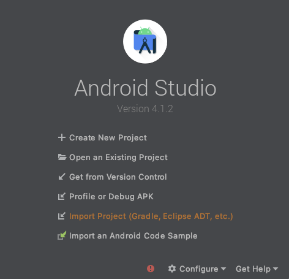
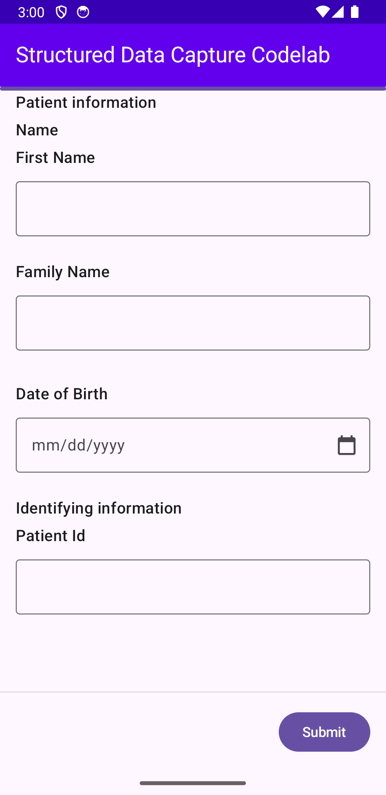

# Capture and process health data with Kotlin FHIR Data Capture

## 1. Before you begin

### What you'll build

In this codelab, you're going to build an Android app with the Kotlin FHIR Data Capture library.
Your app will use the library to render and process FHIR Questionnaires and responses.

The app keeps its logic in a Kotlin Multiplatform (KMP) `shared` module. The codelab runs on
Android, but you can add other platforms later without changing the shared code.

### What you'll learn

*   How to add Kotlin FHIR Data Capture to a Kotlin Multiplatform project
*   How to display a Questionnaire
*   How to get answers as a QuestionnaireResponse
*   How to extract FHIR resources from a QuestionnaireResponse

### What you'll need

*   A recent version of [Android Studio](https://developer.android.com/studio)
*   [Android Emulator](https://developer.android.com/studio/run/emulator) or a physical Android device
*   The sample code
*   Basic knowledge of Kotlin and [Jetpack Compose](https://developer.android.com/compose)

This codelab is focused on
[Kotlin FHIR Data Capture](https://github.com/ohs-foundation/kotlin-fhir-data-capture).
Non-relevant concepts and code blocks are glossed over and are provided for you to simply copy and
paste.

## 2. Get set up

### Download the code

Clone the repository:

```shell
git clone https://github.com/ohs-foundation/kotlin-fhir-data-capture.git
```

The project for this codelab is located in `codelabs/`. It contains the completed code. Each step
of this codelab is marked with a numbered comment, for example `// 4 Display the questionnaire`. To
follow along from the start, delete the code below each numbered comment and add it back as you go.

### Project structure

| Module       | Contents                                                                                     |
|:-------------|:---------------------------------------------------------------------------------------------|
| `shared`     | Kotlin Multiplatform module. `commonMain` holds the `App()` composable and the questionnaire. |
| `androidApp` | Android application. `MainActivity` calls `setContent { App() }`.                             |

The questionnaire is stored as a
[Compose Multiplatform resource](https://www.jetbrains.com/help/kotlin-multiplatform-dev/compose-multiplatform-resources.html)
at `shared/src/commonMain/composeResources/files/questionnaire.json`, so every platform can read it.

### Import the app into Android Studio

Open Android Studio, select **Open**, and choose the `codelabs` folder.



### Run the app

Connect your Android device to your computer, or
[start the Android Studio emulator](https://developer.android.com/studio/run/emulator). Then select
the `androidApp` run configuration and click **Run** in the Android Studio toolbar.

You can also build the app from the command line:

```shell
./gradlew :androidApp:installDebug
```

## 3. Add Kotlin FHIR Data Capture to the project

Add the library to the `commonMain` dependencies in `shared/build.gradle.kts`:

```kotlin
kotlin {
  sourceSets {
    commonMain.dependencies {
      // ...

      // 3 Add the dependency for the Structured Data Capture Library
      implementation("dev.ohs.fhir:fhir-data-capture:2.0.0-alpha05")
    }
  }
}
```

Because the dependency is in `commonMain`, Gradle selects the correct artifact for each target
platform. The `androidApp` module gets the library through its dependency on `shared`.

Select **Sync Project with Gradle Files** in the Android Studio toolbar to download the
dependency.

## 4. Display a Questionnaire

In this step, you load the questionnaire and render it with the `Questionnaire` composable.

Open `shared/src/commonMain/kotlin/dev/ohs/fhir/codelab/App.kt`. The `App()` composable already
loads the questionnaire JSON from the resources:

```kotlin
var questionnaireJson by remember { mutableStateOf<String?>(null) }
LaunchedEffect(Unit) {
  questionnaireJson = Res.readBytes("files/questionnaire.json").decodeToString()
}
val scope = rememberCoroutineScope()
```

Add the following code below the `// 4 Display the questionnaire` comment:

```kotlin
questionnaireJson?.let { questionnaireJson ->
  Questionnaire(
    questionnaireJson = questionnaireJson,
    onSubmit = { getQuestionnaireResponse ->
      scope.launch { submitQuestionnaire(questionnaireJson, getQuestionnaireResponse()) }
    },
    onCancel = {},
  )
}
```

The `Questionnaire` composable takes the questionnaire as a JSON string. You do not need to know
the structure of a FHIR Questionnaire to render it. The library does this for you.

When the user taps **Submit**, the library calls `onSubmit`. The `getQuestionnaireResponse`
argument is a suspend function. It validates the answers and then returns the response. If
validation fails, the library shows a dialog that lists the invalid fields, and the coroutine is
cancelled. You do not need to handle validation errors yourself.

Run the app. You should see something similar to this:

<p align="left">

</p>

Navigate through the questionnaire and enter some answers. The library selects a widget for each
question from the item type in the questionnaire: text fields for `string` items and a date picker
for the `date` item.

*That is all you need to render a questionnaire!*

A questionnaire is not very helpful if you cannot see the answers. In the next step, you get the
answers as a QuestionnaireResponse.

## 5. Get a Questionnaire Response

Find the `submitQuestionnaire()` function and add the following code below the
`// 5 Print the questionnaire response` comment:

```kotlin
println("response: ${json.encodeToString(questionnaireResponse)}")
```

`questionnaireResponse` is a
[Kotlin FHIR](https://github.com/ohs-foundation/kotlin-fhir) `QuestionnaireResponse`. You can use it
directly or encode it to JSON. The codelab encodes it with `kotlinx.serialization` and prints it.
On Android, `println` output is shown in Logcat.

Run the app, answer the questions, and tap **Submit**. In Logcat, search for `response:` to see the
QuestionnaireResponse.

## 6. Extract FHIR Resources from a QuestionnaireResponse

The questionnaire is for a simple patient registration flow. You probably want to use the answers
to create a [FHIR Patient resource](https://www.hl7.org/fhir/R4/patient.html). This conversion from
a questionnaire response to FHIR resources is called
[data extraction](https://hl7.org/fhir/uv/sdc/STU4/extraction.html).

The library implements
[template-based extraction](https://hl7.org/fhir/uv/sdc/STU4/extraction.html#template-extract). For
this method, the questionnaire must contain a template of the resource to create. Open
`questionnaire.json` and look at these parts:

*   The `contained` array has a `Patient` resource with the ID `patient-template`. This is the
    template.
*   The `sdc-questionnaire-templateExtract` extension on the questionnaire refers to the template
    with `#patient-template`.
*   In the template, each field that comes from an answer has a
    `sdc-questionnaire-templateExtractValue` extension. The extension contains a FHIRPath
    expression that selects the answer. For example, this expression selects the family name:

    ```
    %resource.repeat(item).where(linkId='PR-name-family').answer.value.first()
    ```

*   Fields without an extension, such as the identifier `system`, are copied to the extracted
    resource as they are.

Add the following code below the `// 6 Extract FHIR resources from the questionnaire response`
comment:

```kotlin
val questionnaire = json.decodeFromString<FhirQuestionnaire>(questionnaireJson)
val bundle = TemplateExtractionEngine.extract(questionnaire, questionnaireResponse)
println("extraction result: ${json.encodeToString(bundle)}")
```

`TemplateExtractionEngine.extract()` takes the questionnaire and the questionnaire response. It
returns a transaction `Bundle` that contains the extracted resources. In this codelab, the Bundle
contains one Patient resource.

Run the app, submit the questionnaire, and search Logcat for `extraction result:` to see the
Bundle.

## 7. Congratulations!

You used Kotlin FHIR Data Capture to process FHIR questionnaires and responses in your app:

*   Display a Questionnaire
*   Get a Questionnaire Response
*   Extract FHIR Resources from a QuestionnaireResponse

### What we've covered

*   How to add Kotlin FHIR Data Capture to a Kotlin Multiplatform project
*   How to use the `Questionnaire` composable and `TemplateExtractionEngine` to work with FHIR
    questionnaires

### Next steps

*   Run the codelab on other platforms. Add targets such as `jvm()`, `wasmJs { browser() }`, or
    `iosArm64()` to `shared/build.gradle.kts`, then add an entry point for each platform. The
    [catalog app](../catalog) shows how to do this.
*   Customize the questionnaire with `QuestionnaireConfig`, for example to show a review page
*   Read the [conformance](../docs/conformance.md) document to see which Questionnaire and SDC
    features the library supports
